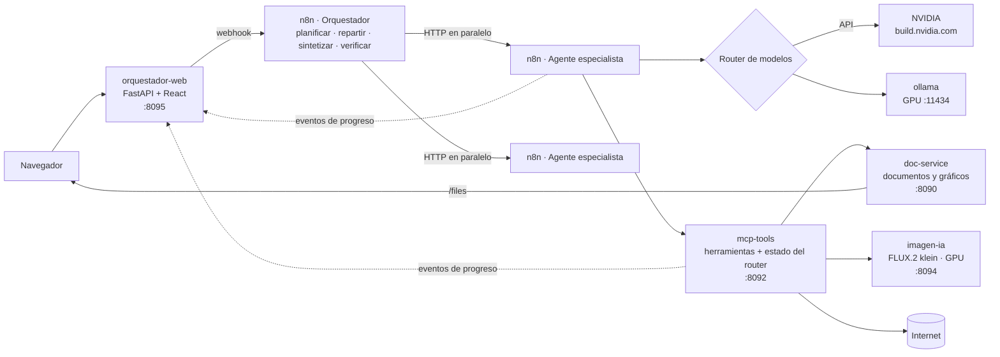

# Agentes

Orquestador multi-agente local sobre **n8n**: un planificador divide cada pedido en subtareas, las reparte entre
agentes especialistas que corren **en paralelo**, integra las respuestas y un verificador revisa que se cumpla todo
lo pedido antes de entregarlo. Usa modelos de **NVIDIA** (API remota) y **Ollama** (locales, en la GPU), herramientas
propias por **MCP**, generación de documentos e imágenes, y una **web local** con el historial de chats.

- [Funcionalidades](#funcionalidades)
- [Arquitectura](#arquitectura)
- [Modelos elegidos y por qué](#modelos-elegidos-y-por-qué)
- [Requisitos del sistema](#requisitos-del-sistema)
- [Instalación](#instalación)
- [Seguridad](#seguridad)
- [Mantenimiento](#mantenimiento)

---

## Funcionalidades

### Orquestación
- **Planificación**: el orquestador divide el pedido en hasta 3 subtareas y elige agente y complejidad para cada una.
- **Agentes en paralelo**: cada subtarea es una ejecución separada del agente especialista (webhook de n8n).
- **Síntesis**: si respondieron varios agentes, el orquestador integra todo en una sola respuesta.
- **Verificación**: un verificador controla que la respuesta cumpla todo lo pedido; si falta algo, el agente lo
  completa (una vez).
- **Memoria por chat**: cada agente recuerda los últimos intercambios del chat (separada por agente y por subtarea).
- **Adjuntos**: PDF, Word, Excel, CSV, JSON, HTML y texto se convierten a texto y se suman al pedido.

### Agentes especialistas
10 agentes; 8 llevan en el prompt el catálogo de **430 skills de NVIDIA** de su área:

| Agente | Especialidad |
|---|---|
| `general` | Tareas simples: cálculos, conversiones, fechas, resumir archivos o webs, tablas |
| `visualizacion` | Gráficos, diagramas, imágenes con IA, portadas, edición de imágenes, infografías (skills propias) |
| `agentic_ai` | Agentes, RAG, guardrails, IA conversacional, ciberseguridad |
| `fisica_robotica` | Robótica, simulación, Jetson, vehículos autónomos, gemelos digitales |
| `vision` | Visión por computadora, video analytics, DeepStream, Metropolis |
| `entrenamiento_inferencia` | Entrenamiento, fine-tuning, NeMo, TensorRT, NIM, Dynamo |
| `datos_optimizacion` | Ciencia de datos (RAPIDS), optimización (cuOpt), computación cuántica |
| `gpu_dev` | CUDA, librerías GPU, profiling, gaming/RTX |
| `infra_redes` | Clusters, Kubernetes, AI Factory, almacenamiento, redes (DOCA, InfiniBand) |
| `salud_ciencias` | Salud y ciencias de la vida (BioNeMo, Clara, MONAI) |

### Router de modelos
- Elige el modelo según el agente y la complejidad: tareas simples del agente general van primero a **Ollama local**;
  el resto, a **NVIDIA**, con Ollama como último respaldo.
- Respeta el límite de la cuenta NVIDIA (~40 pedidos/minuto) y límites propios por modelo (por minuto y por día).
- Si un modelo falla, lo pone en pausa según el error y prueba el siguiente:

  | Error | Pausa |
  |---|---|
  | 429 / límite de uso | 1, 2, 4, 8 y hasta 15 min (crece con cada falla seguida) |
  | 404 / modelo dado de baja | 24 h |
  | 5xx, timeout o conexión cortada | 2 min |

- El estado (usos, pausas, errores) vive en mcp-tools (`/router/*`), así los agentes en paralelo no se pisan.

### Herramientas (servidor MCP propio)
Reglas de uso en [mcp-tools/reglas.md](mcp-tools/reglas.md), para que el agente no tenga que decidir qué usar.

| Herramienta | Para qué |
|---|---|
| `calculadora`, `fecha_hora`, `convertir_unidades`, `tabla` | Cuentas exactas (también días entre fechas), fecha actual, unidades, tablas |
| `leer_url`, `leer_archivo` | Texto de una página o de un archivo (PDF, Word, Excel, CSV...) |
| `buscar_web` | Búsqueda en internet |
| `navegador` | Navegar, hacer clic, escribir, completar formularios, extraer tablas, capturas. Dos motores: Playwright y Selenium (+ BeautifulSoup) |
| `como_llegar` | Rutas de Google Maps (auto, a pie, transporte público) |
| `generar_documento` | HTML, PDF, Word, Excel y Markdown con gráficos y diagramas |
| `crear_grafico`, `crear_diagrama` | Gráficos (barras, línea, torta, dispersión, mapa de calor...) y diagramas |
| `crear_imagen`, `editar_imagen` | Portadas y banners con texto; redimensionar, recortar, collage, etc. |
| `generar_imagen` | Imágenes con IA (FLUX.2 klein en la GPU) |

Cada tipo de agente ve solo las herramientas que necesita (perfiles `planificador`, `basicas`, `adjuntos`, `todas`).

### Web local (http://localhost:8095)
- Registro de chats para consultarlos y retomarlos (renombrar, borrar, reintentar).
- **Progreso en vivo** en una línea: plan, razonamiento, agentes, modelos y herramientas que se están usando.
- Botón **Modelos**: modelos locales y remotos, su uso, pausas y errores.
- Muestra imágenes y links de descarga de los archivos generados; cada respuesta queda también como HTML.

---

## Arquitectura



| Servicio | Qué es | Puerto | RAM máx. |
|---|---|---|---|
| `n8n-container` | n8n 2.x: workflows del orquestador y los agentes, credenciales cifradas | 5678 | 2 GB |
| `n8n-runners` | Ejecuta los nodos de código de n8n (task runners) | — | 1 GB |
| `ollama` | Modelos locales en la GPU (volumen `agentes_ollama`) | 11434 | 6 GB |
| `imagen-ia` | Imágenes con IA en la GPU (volumen `agentes_imagen_modelos`) | 8094 | 6 GB |
| `mcp-tools` | Servidor MCP (Python): herramientas, navegador Chromium/Chrome, estado del router | 8092 | 3 GB |
| `doc-service` | Genera HTML, PDF, Word, Excel y MD; sirve `/files` | 8090 | 1 GB |
| `orquestador-web` | Web local (FastAPI + React, chats en SQLite) | 8095 | 512 MB |

**GPU compartida**: Ollama e imagen-ia usan la misma GPU. Antes de cargar FLUX, imagen-ia le pide a Ollama que
libere sus modelos y, tras 3 minutos sin uso, libera la VRAM para que Ollama la vuelva a usar.

### Carpetas

| Carpeta | Contenido |
|---|---|
| `generador` | `build/gen.py` genera los workflows de n8n (`workflows/*.json`); código JS del router en `build/*.js` |
| `mcp-tools` | Servidor MCP y reglas de las herramientas |
| `imagen-ia` | Servicio de imágenes con IA (diffusers) |
| `doc-service` | Generador de documentos y gráficos |
| `orquestador-web` | Backend FastAPI y frontend React |
| `n8n/n8n_data` | Datos de n8n (workflows, credenciales cifradas, historial) — no se sube a git |
| `documentos_generados` | Archivos que generan los agentes — no se sube a git |

### Workflows de n8n

| Workflow | Para qué |
|---|---|
| NVIDIA · Agente especialista (router de LLM) | Elige el modelo, usa las herramientas MCP, memoria por chat, avisa el progreso. Webhooks `agente-especialista` y `estado-modelos` |
| NVIDIA · Orquestador (webhook para la web) | `POST /webhook/orquestador`: planifica, reparte en paralelo, sintetiza y verifica |
| NVIDIA · Orquestador multi-agente | El mismo orquestador para el chat de n8n (Open chat) |

Para cambiarlos: editar `generador/build/*` y correr `python generador/build/gen.py`; los JSON quedan en
`generador/workflows/` y se importan pegándolos en n8n (revisar que el selector de modelo, la memoria y el nodo MCP
sigan conectados al agente) y **publicar** (los webhooks usan la versión publicada).

---

## Modelos elegidos y por qué

La configuración está en [generador/build/config_modelos.js](generador/build/config_modelos.js). Velocidades medidas
en esta PC en octubre de 2026.

### Locales (Ollama, RTX 3060 12 GB)

| Modelo | Disco | Uso | Por qué |
|---|---|---|---|
| `nemotron-3.5-bolt:e4b` | 7,9 GB | Primero para tareas simples | Rápido (~100 tok/s), buen tool calling. Entra en la GPU junto con nano |
| `nemotron-3-nano:4b` | 2,8 GB | Segundo para tareas simples | Muy liviano; las subtareas en paralelo se alternan entre bolt y nano para no hacer cola |
| `qwen3:14b` | 9,3 GB | Código, infraestructura y respaldo | El de mejor calidad para razonar y programar que entra en 12 GB |
| `gemma4:12b` | 8 GB | Visión y respaldo | Entiende imágenes |

Se desinstalaron `gemma4:latest`, `glm4`, `llama3.1:8b` y `qwen2.5-coder:7b` (~23 GB): quedaban cubiertos por
estos cuatro con mejor calidad o velocidad, y casi no los elegía el router. También se sacó `deepseek-v4-flash:cloud`
(servido por ollama.com, con cuota propia): NVIDIA ya cubre ese rol.

### Remotos (API de NVIDIA)

| Rol | Primer modelo | Por qué |
|---|---|---|
| Orquestador (planificar) y síntesis | `nemotron-3-ultra-550b-a55b` | El mejor siguiendo instrucciones y armando el plan JSON |
| Verificador, agente general, visualización | `nemotron-3.5-lightning-30b-a3b` | MoE rápido; ultra tardaba más de 100 s en revisar |
| Visión | `nemotron-3.5-super-vl-120b-a12b` | Modelo de visión y lenguaje |
| Entrenamiento e inferencia | `deepseek-v4.1-flash` | Rápido y bueno en temas técnicos |
| Datos y optimización | `gpt-oss-20b` | Rápido y bueno con números |
| Desarrollo GPU | `step-5-preview` | Fuerte en código (si se cuelga queda en pausa y sigue `minimax-m3.1-flash`) |
| Infraestructura y redes | `minimax-m3.1-flash` | Rápido, buen tool calling |

Cada agente tiene 4 modelos en orden de preferencia, y después una lista general de respaldo (`fallbackGeneral`).
`mistral-large-4`, `glm-5.3`, `gemma-4-31b`, `laguna` y `nano-omni` quedaron como respaldo porque tardaban más de 45 s.

### Imágenes

| Modelo | Por qué |
|---|---|
| **FLUX.2 [klein] 4B** (Black Forest Labs, Apache 2.0) | Sigue mejor el prompt que SDXL y escribe bien textos cortos (carteles, títulos). Con el text encoder Qwen3-4B en 4 bits (NF4) y el transformer en bf16 entra en 12 GB. ~17 s por imagen de 1024×1024 con el modelo cargado; ~1,5 min la primera carga. Las imágenes se generan de a una y hasta ~1 megapíxel (juntas o más grandes desbordan la VRAM) |
| SDXL-Lightning (alternativa, `IMAGEN_MODELO=sdxl-lightning`) | ~4 s, pero peor calidad y sin texto legible. Sus pesos no están descargados: se bajan (~7 GB) la primera vez que se use |

Los modelos "Downloadable" de build.nvidia.com (contenedores NIM) piden GPUs RTX 40/50 o superiores y no corren en
la RTX 3060 (Ampere); FLUX.2 klein se usa con sus pesos abiertos de Hugging Face y `diffusers`.

---

## Requisitos del sistema

### Equipo usado (de referencia)
- Windows 11 Pro, AMD Ryzen 7 5700G, 32 GB de RAM
- NVIDIA GeForce RTX 3060 de 12 GB (driver 576)
- Docker Desktop 4.86 con WSL 2

### Mínimos

| Recurso | Mínimo | Notas |
|---|---|---|
| GPU | NVIDIA con 12 GB de VRAM | Para FLUX y los modelos locales de 8–9 GB. Driver ≥ 570 (CUDA 12.8). Con 8 GB: usar solo los modelos chicos y `FLUX_TRANSFORMER=nf4` |
| RAM | 32 GB recomendados | Los contenedores suman ~20 GB de tope; WSL está limitado a 12 GB + 4 GB de swap |
| Disco | ~100 GB libres | Ollama ~28 GB, FLUX ~16 GB, imágenes de Docker ~35 GB, más documentos y caché |
| Software | Docker Desktop con WSL 2 y soporte de GPU NVIDIA | Ollama e imagen-ia usan `deploy.resources.devices` con `driver: nvidia` |
| Cuenta | API key de NVIDIA (build.nvidia.com) | Gratuita, ~40 pedidos/minuto |
| Red | Internet | API de NVIDIA, búsquedas, navegación y la primera descarga de modelos |

### Límites de WSL (`%USERPROFILE%\.wslconfig`)

```ini
[wsl2]
memory=12GB
swap=4GB

[experimental]
autoMemoryReclaim=gradual
sparseVhd=true
```

---

## Instalación

```bash
cp .env.default .env      # completar las claves (ver Seguridad)
docker compose up -d --build
docker exec ollama ollama pull nemotron-3.5-bolt:e4b
docker exec ollama ollama pull nemotron-3-nano:4b
docker exec ollama ollama pull qwen3:14b
docker exec ollama ollama pull gemma4:12b
```

Después, en n8n (http://localhost:5678):
1. Crear la credencial **"OpenAI account"** con la API key de NVIDIA y la URL base `https://integrate.api.nvidia.com/v1`.
2. Crear la credencial **"Ollama account"** con la URL `http://ollama:11434`.
3. Importar los tres JSON de `generador/workflows/`, elegir esas credenciales en los nodos de modelo (los JSON traen
   los IDs de esta instalación, en `generador/build/ids.json`) y publicarlos.

Los pesos de FLUX (~16 GB) se descargan solos la primera vez que se pide una imagen.

Para generar cada clave:

```bash
python -c "import secrets; print(secrets.token_urlsafe(32))"
```

Reconstruir un solo servicio después de cambiar su código, por ejemplo la web:

```bash
docker compose up -d --build orquestador-web
```

---

## Seguridad

- Todos los puertos escuchan solo en `127.0.0.1` (`BIND_IP` en `.env`).
- Toda la configuración está en `.env` (fuera de git); `.env.default` es la plantilla sin datos.
- Cada servicio tiene su clave:

| Servicio | Qué protege | Cómo se manda |
|---|---|---|
| n8n (webhooks `orquestador`, `agente-especialista`, `estado-modelos`) | `N8N_WEBHOOK_TOKEN` | header `X-API-Key` |
| imagen-ia (`POST /generar`) | `IMAGEN_IA_API_KEY` | header `X-API-Key` (lo usa el MCP) |
| mcp-tools (`/mcp` y `/router`) | `MCP_API_KEY` | `Authorization: Bearer`, `X-API-Key` o `?key=` (n8n lo pone en la URL desde `$env`; en los logs aparece como `key=***`) |
| doc-service (`POST /documento`, `/imagen`) | `DOC_SERVICE_API_KEY` | header `X-API-Key` (las descargas `/files` quedan libres en localhost para abrir los links) |
| orquestador-web (`/api/*`) | `WEB_ACCESS_TOKEN` | la interfaz la pide al entrar y la manda en `X-API-Key` |
| orquestador-web (`/api/eventos`) | `WEB_EVENTOS_TOKEN` | header `X-API-Key` (lo usan n8n y el MCP) |

- n8n lee claves y URLs con `$env` (`N8N_BLOCK_ENV_ACCESS_IN_NODE=false`): no quedan escritas en los workflows.
  Contra: cualquier workflow de esta instancia puede leer esas variables.
- La API key de NVIDIA está cifrada dentro de n8n con `N8N_ENCRYPTION_KEY`.
- Ollama no tiene autenticación: escucha solo en `127.0.0.1` y en la red interna de Docker; no lo expongas fuera de la PC.
- El navegador del MCP bloquea direcciones de la red interna y de los contenedores.

---

## Mantenimiento

```bash
docker exec ollama ollama list        # modelos instalados
docker exec ollama ollama ps          # modelos cargados en la GPU
docker system df                      # espacio usado por Docker
```

**Recuperar espacio en Windows**: el disco virtual de Docker (`%LOCALAPPDATA%\Docker\wsl\disk\docker_data.vhdx`) no
se achica solo al borrar modelos o imágenes. Para devolver el espacio: `docker builder prune -f`, cerrar Docker
Desktop (`docker desktop stop` y `wsl --shutdown`) y, en PowerShell como administrador:

```powershell
Mount-VHD -Path "$env:LOCALAPPDATA\Docker\wsl\disk\docker_data.vhdx" -ReadOnly
Optimize-VHD -Path "$env:LOCALAPPDATA\Docker\wsl\disk\docker_data.vhdx" -Mode Full
Dismount-VHD -Path "$env:LOCALAPPDATA\Docker\wsl\disk\docker_data.vhdx"
```

**Si n8n da "Task request timed out"**: `docker compose restart n8n-runners`.
